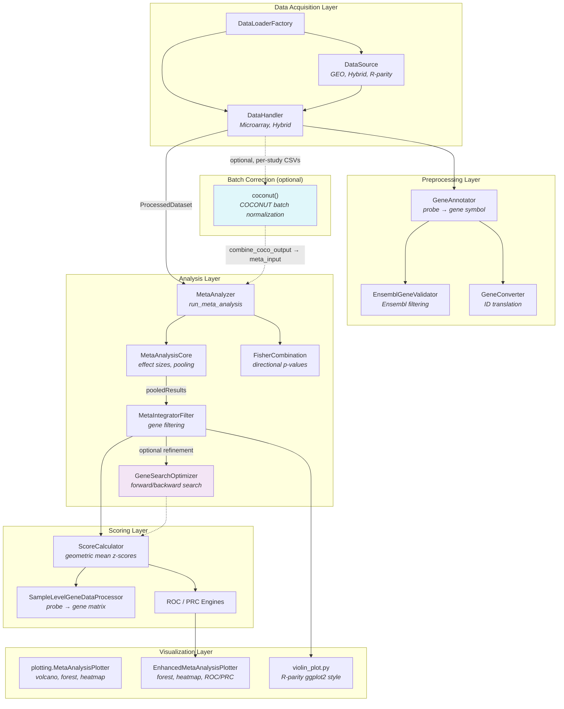
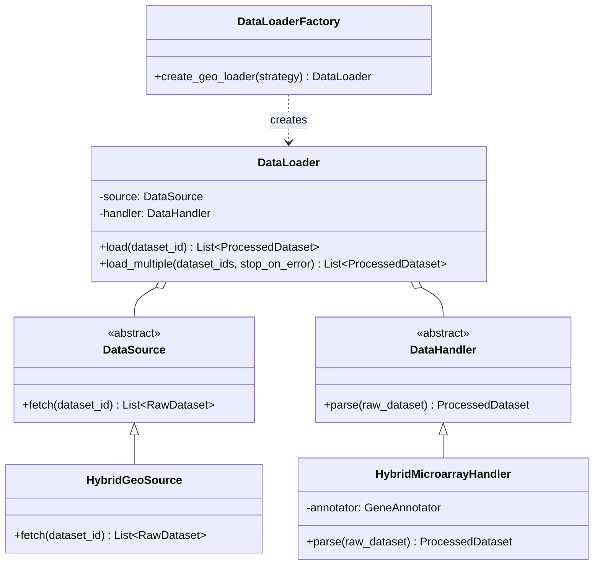
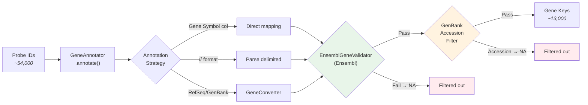
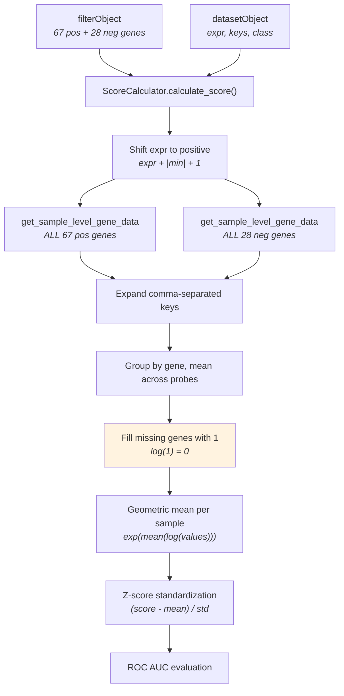

# Architecture Overview

MetaIntegrator-py follows a layered, object-oriented architecture designed around the
**Open/Closed Principle**: new data sources, handlers, and analyses can be added without
modifying existing code.

## High-Level System Architecture



## Module Map

| Package | Module | Responsibility |
|---------|--------|---------------|
| **preprocessing** | `base.py` | Abstract base classes: `DataSource`, `DataHandler`, `DataLoader`, `ProcessedDataset` |
| | `loader_factory.py` | `DataLoaderFactory` — single entry point for creating loaders |
| | `geo_sources.py` | `NCBIGeoSource` — Series Matrix fetching; `GEOparseSource` — full SOFT-based fetching (the `'full'` strategy) |
| | `hybrid_source.py` | `HybridGeoSource` — Series Matrix expr + GEOparse annotation |
| | `hybrid_handler.py` | `HybridMicroarrayHandler` — orchestrates annotation, log2, pheno |
| | `microarray_handler.py` | `MicroarrayHandler` — full SOFT-based processing |
| | `gene_annotator.py` | `GeneAnnotator` — probe-to-gene mapping with GenBank/Ensembl filters |
| | `gene_validation.py` | `EnsemblGeneValidator` — HGNC symbol validation |
| | `gene_converter.py` | `GeneConverter` — Ensembl ↔ Entrez ↔ RefSeq ↔ GenBank translation |
| | `ncbi_fetcher.py` | `NCBIFetcher` — Series Matrix downloader behind the `'fast'` strategy, with size guard and pickle caching |
| | `ncbi_network.py` | `NCBINetwork` — low-level FTP/HTTPS transport with retry & disk caching, the injectable seam used by every source |
| | `r_parity_handler.py`, `r_parity_source.py` | **Deprecated aliases** — re-export `HybridMicroarrayHandler`/`HybridGeoSource` under their old names; not separate implementations |
| | `r_parity_loader.py` | `load_geo_datasets_r_parity()` — backward-compatible function wrapper around `DataLoaderFactory(strategy='r_parity')`, kept for older notebooks/tests |
| **metaintegrator** | `analysis.py` | `MetaAnalyzer` — top-level orchestrator for meta-analysis |
| | `core_analysis.py` | `MetaAnalysisCore`, `FisherCombination` — statistical engine |
| | `score_calculation.py` | `ScoreCalculator` — geometric-mean z-score computation |
| | `sample_level_gene_data.py` | `SampleLevelGeneDataProcessor` — probe-level to gene-level extraction |
| | `scoring_meta_integrator_filter.py` | `MetaIntegratorFilter` — gene filtering by FDR, effect size, leave-one-out |
| | `gene_search_optimizer.py` | `GeneSearchOptimizer` — AUC-driven `forward_search()` / `backward_search()` signature refinement |
| | `scoring_meta_integrator_orchestrator.py` | End-to-end scoring orchestration |
| | `roc_analysis_engine.py` | ROC curve computation and multi-dataset ROC plots |
| | `prc_analysis.py` | Precision-recall curve analysis |
| | `power_calculation.py` | Statistical power estimation |
| | `phenotype_processing.py` | Phenotype/class label extraction |
| | `validation.py` | Dataset structure validation |
| **visualization** | `plotting.py` | `MetaAnalysisPlotter` — volcano, forest, heatmap, effect-size distribution |
| | `enhanced_plotting.py` | `EnhancedMetaAnalysisPlotter` — forest/heatmap/Manhattan/ROC/PRC/violin/regression, plus module-level convenience functions. Previously also named `MetaAnalysisPlotter`; renamed to stop colliding with `plotting.MetaAnalysisPlotter` (an unrelated class). A deprecated, warning-emitting alias remains for old imports — see [Visualization API](api/visualization.md). |
| | `violin_plot.py` | R-parity violin plots (ggplot2 style) |
| **coconut** | `coconut.py` | COCONUT batch normalization |
| | `coconut_runner.py` | CLI runner for COCONUT workflows |

---

## Data Acquisition: Factory Pattern

The preprocessing layer uses a **Factory + Strategy** pattern. Users never instantiate
sources or handlers directly — `DataLoaderFactory` wires everything together.



**Strategies available:**

| Strategy | Source | Handler | Use case |
|----------|--------|---------|----------|
| `hybrid` / `r_parity` | `HybridGeoSource` | `HybridMicroarrayHandler` | Production — matches R output |
| `full` | `GEOparseSource` | `MicroarrayHandler` | Full SOFT download |
| `fast` | `NCBIGeoSource` | `MicroarrayHandler` | Quick exploration |

```python
from preprocessing.loader_factory import DataLoaderFactory

# Recommended: R-parity mode
loader = DataLoaderFactory.create_geo_loader(strategy='r_parity')
datasets = loader.load_multiple(['GSE11909', 'GSE50635'])
```

---

## Gene Annotation Pipeline

The annotation pipeline converts probe IDs to HGNC gene symbols with two levels
of filtering for R-parity:



**Key design decisions for R-parity:**

1. **Ensembl validation** (`EnsemblGeneValidator`) — rejects non-HGNC symbols like LOC*, ORFs,
   and mitochondrial gene aliases. Controlled via `validator` parameter in `HybridMicroarrayHandler`.
2. **GenBank accession filter** (`GeneAnnotator.GENBANK_ACCESSION_RE`) — rejects accession IDs
   (AF*, AK*, BC*, etc.) that some platforms include alongside gene symbols.
3. Both filters together produce gene counts matching R within ±5 per platform.

---

## Scoring Pipeline

Score calculation converts a gene signature (from `filterGenes`) into per-sample
meta-scores for classification:



**Critical R-parity detail:** All gene names are passed to `get_sample_level_gene_data`,
including those not present in the dataset. Missing genes are filled with value `1`
(so `log(1) = 0` enters the geometric mean), matching R's `calculateScore` behavior.
This was previously a pre-filter bug that caused AUC regression.

---

## Quick Start for New Developers

### Running the SLE tutorial end-to-end

```bash
cd tutorials/
jupyter notebook jupyter_metaintegrator_sle_tutorial.ipynb
```

### Understanding the call chain

1. **Load data**: `DataLoaderFactory.create_geo_loader('r_parity')` → `HybridMicroarrayHandler.parse()` → `GeneAnnotator.annotate()`
2. **Meta-analysis**: `MetaAnalyzer.run_meta_analysis()` → `MetaAnalysisCore.calculate_effect_sizes()` → `pool_inverse_variance()`
3. **Filter genes**: `MetaAnalyzer.filter_genes()` (in `analysis.py`) → returns `filter_object` with `posGeneNames` / `negGeneNames`.
   A separate, strategy-based pipeline — `scoring_meta_integrator_filter.MetaIntegratorFilter` — also exists (standard / adaptive / combined-criteria); the two are not interchangeable, see [API Reference](api/overview.md#package-metaintegrator).
4. **Refine signature (optional)**: `GeneSearchOptimizer.forward_search()` / `.backward_search()` (in `gene_search_optimizer.py`) iteratively add/remove genes from `filter_object` based on their contribution to weighted AUC. See [User Guide: Gene Filtering](user_guide/filtering.md#metaintegrator_pys-built-in-gene-filtering).
5. **Score & evaluate**: `ScoreCalculator.calculate_score()` → `SampleLevelGeneDataProcessor` → ROC/AUC

### Key data structures

```python
# ProcessedDataset (from preprocessing)
dataset = {
    "expr":  pd.DataFrame,   # probes × samples
    "keys":  List[str],      # gene symbol per probe (comma-separated for multi-gene)
    "class": np.ndarray,     # 0=control, 1=disease
    "pheno": pd.DataFrame,   # sample metadata
    "geo_id": str,           # e.g. "GSE11909_GPL96"
}

# filter_object (from filterGenes)
filter_object = {
    "posGeneNames": List[str],  # up-regulated signature genes
    "negGeneNames": List[str],  # down-regulated signature genes
    "FDRThresh": float,
    "effectSizeThresh": float,
}
```
